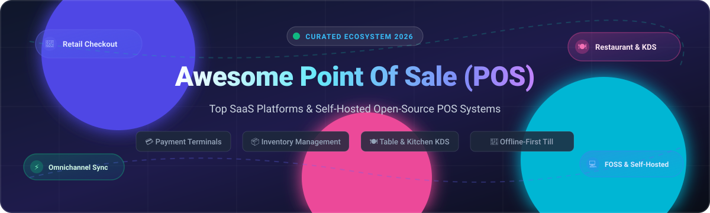

# 🛒 Awesome Point Of Sale (POS) Systems & Ecosystem

  

  
  
  
  
  
  

> 🚀 **The definitive curated index of top Point of Sale (POS) SaaS platforms, self-hosted open-source cashier engines, retail management systems, and restaurant kitchen display setups.**

**Last updated: October 2026**

---

## 📖 Overview

Point of Sale (POS) platforms are the operational and transactional backbone for modern retail stores, cafes, multi-outlet restaurants, and omnichannel commerce. This repository provides an extensively researched reference guide comparing **market-leading enterprise SaaS platforms** with **production-ready open-source GitHub projects**.

Whether you are looking for an integrated hardware ecosystem (like Square or Shopify POS), an enterprise cloud terminal system (Toast, NCR Voyix, Clover), or complete data sovereignty with an offline-first open-source till (Odoo POS, NexoPOS, POS Awesome), this guide covers architecture, transparent starting pricing, free tier limits, and developer tools.

### 🌟 Key Highlights
* 🏢 **Commercial SaaS Solutions**: Detailed breakdowns of market capitalization, real entry-level pricing tiers, and specific free tier / trial parameters.
* 💻 **Open-Source Checkout Software**: Star-ranked, self-hosted repositories for retail, quick-service dining, bars, and ERP integrations.
* 💳 **Payment & Hardware Realities**: Clear technical disclaimers on PCI-DSS compliance, card-present hardware terminals, and EMV payment processing.

---

## 📑 Table of Contents

- [📊 Sector Overview & Market Dynamics](#-sector-overview--market-dynamics)
- [☁️ SaaS/Hosted Platforms](#-saashosted-platforms)
- [💻 Open-Source GitHub Projects](#-open-source-github-projects)
- [🤝 How to Contribute](#-how-to-contribute)
- [💖 Support & Community](#-support--community)
- [📈 Star History](#-star-history)
- [⚠️ Disclaimer](#-disclaimer)

---

## 📊 Sector Overview & Market Dynamics

The global Point of Sale (POS) software market is estimated at approximately **$16.1B to $17.1B in 2025** and projected to reach **$18.0B to $19.2B in 2026**, expanding at a compound annual growth rate (**CAGR of 10.5%–12.4%**). 

Market concentration follows a bifurcated dynamic:
* 🏪 **High Fragmentation among SMBs & Independent Retailers:** The lower-to-middle tier is served by thousands of localized ISVs, regional payment vendors, and micro-vertical solutions tailored to specific regional tax/fiscal regulations.
* 🏛️ **Moderate Concentration at the Enterprise Level:** The enterprise tier is consolidated around a handful of unified commerce giants (**Shopify**, **Block/Square**, **Fiserv/Clover**, **Toast**, and **NCR Voyix**) that leverage closed payment processing networks, dedicated hardware suites, and cross-channel commerce APIs to build durable customer lock-in.

---

## ☁️ SaaS/Hosted Platforms

| 🏷️ Platform | 💰 Market Cap / Valuation / Scale | 🏷️ Starting Pricing | 🎁 Free Tier / Free Trial Limits | 📝 Description & Target Use Case |
| :--- | :--- | :--- | :--- | :--- |
| **[Shopify POS](https://www.shopify.com/pos)** | ~$215B – $222B MCap ($11.6B Rev) | $39/mo (Basic plan including POS Lite); POS Pro add-on at $89/mo per location | 3-day free trial (no credit card required), followed by $1/mo promotional pricing for first 3 months; no permanent free tier | Omnichannel point of sale integrated directly with Shopify ecommerce, customer profiles, inventory, and multichannel orders. |
| **[Square POS](https://squareup.com/)** | ~$45B MCap ($24B – $25B Rev) | $0/mo (Free tier, pay 2.6% + 15¢ per transaction); Square for Retail Plus starts at $89/mo per location | Free forever plan with unlimited items, basic inventory, and digital invoicing; restricted from advanced purchase orders, multi-location stock transfers, and automated inventory sync | Full-service point of sale app for iOS/Android and Square hardware with built-in payment processing and customer directory. |
| **[Clover](https://www.clover.com/)** | ~$26B – $27B parent Fiserv MCap ($20B – $21B Rev) | $14.95/mo (Register Lite / Essentials); Payments Plus at $4.95/mo; full Register at $49.95/mo | 30-day to 90-day free software trial on Register Lite depending on merchant partner (processing fees still apply); Payments Plus ($4.95/mo) has no free tier and omits inventory tracking | Integrated hardware-software POS ecosystem with modular apps, item tracking, and customer loyalty for retail and dining. |
| **[Toast POS](https://pos.toasttab.com/)** | ~$18B – $19B MCap ($6.8B Rev) | $0/mo (Quick Start software tier, higher processing rate); Standard Point of Sale starts at $69/mo | Free forever Quick Start tier ($0/mo software fee, but locked into proprietary payment processing at elevated rates around 3.09%–3.69% + 15¢; excludes multi-location tools and advanced reporting); no standalone self-serve trial | Dedicated cloud restaurant POS handling table management, menu layout, kitchen display systems (KDS), and online ordering. |
| **[Heartland POS](https://www.heartland.us/)** | ~$22B parent Global Payments MCap (~$2.1B Rev at acquisition) | $89/mo per terminal (Essentials plan) + 2.6% + 10¢ processing | No permanent free tier; 14-to-30 day guided demo / occasional 90-day trial for select online ordering add-on modules only | Robust point-of-sale and payment processing platform with inventory, employee time tracking, and hospitality operations. |
| **[Lightspeed POS](https://www.lightspeedhq.com/)** | ~$1.4B MCap ($1.2B Rev) | $89/mo (Basic, billed annually) or $109/mo (billed monthly) | 14-day free trial with full access to inventory tracking and register layouts; no permanent free tier | Multi-channel cloud POS tailored for specialty retailers and complex restaurant operations with deep supplier catalog integrations. |
| **[NCR Voyix](https://www.ncrvoyix.com/)** | ~$1.1B MCap ($2.4B Rev) | Quote-based / ~$65–$175/mo per terminal (Aloha Cloud / Retail tier) | No free tier or merchant software free trial; offers 90-day developer "Test Drive" trial restricted strictly to API sandbox testing | Enterprise-grade POS and self-service commerce terminals engineered for large retail supermarket chains and multi-unit hospitality operators. |
| **[Vend by Lightspeed](https://www.vendhq.com/)** | Acquired by Lightspeed for $350M (Part of $1.4B MCap) | $89/mo (Integrated Lightspeed Retail Standard tier) | 14-day free trial for retail testing; no permanent free tier | Intuitive retail point-of-sale and inventory platform specialized for independent boutiques and multi-outlet storefronts. |
| **[Revel Systems](https://revelsystems.com/)** | Acquired by Shift4 for $250M (Part of Shift4 Payments ~$3B MCap) | $99/mo per terminal (annual commitment with payment processing agreement) | No permanent free tier and no self-serve free trial (requires live sales demo and custom onboarding) | iPad-based POS system designed for high-volume quick service, restaurant dining, and retail franchises. |
| **[TouchBistro](https://www.touchbistro.com/)** | Private (~$321M venture funding, $100M+ ARR) | $69/mo (Core software plan, billed annually) | No permanent free tier and no public self-service free trial (guided interactive demo required) | iPad and cloud restaurant management system offering floor plans, table turn tracking, menu engineering, and staff management. |

---

## 💻 Open-Source GitHub Projects

Curated list of open-source Point of Sale engines, self-hosted checkout applications, and retail/restaurant frameworks, sorted descending by GitHub stargazers count:

* **[Odoo POS](https://github.com/odoo/odoo)**   
  ⚡ Full-featured POS module within the Odoo open-source ERP suite; runs in a browser on any device and **works offline after initial connection**. Integrates with Odoo Inventory, Accounting, and eCommerce for real-time stock updates, customer loyalty, refunds, and consolidated multi-store reporting. Supports barcode scanning, hardware receipt printing, and multiple payment methods.

* **[BTCPay Server POS](https://github.com/btcpayserver/btcpayserver)**   
  ⚡ Self-hosted, open-source cryptocurrency payment processor with an integrated web Point of Sale app. Allows physical retailers to configure customizable product keypads, tip inputs, and invoice generation for Bitcoin on-chain and Lightning Network payments with zero third-party processing fees.

* **[OSPOS (Open Source Point of Sale)](https://github.com/opensourcepos/opensourcepos)**   
  ⚡ Web-based POS for small to medium retail and hospitality businesses built on PHP/CodeIgniter 4 and MySQL. Features sales register, barcode scanning, receipt printing/emailing, inventory management with item kits, customer/supplier databases, multi-tier taxation, gift cards, restaurant tables, and detailed reporting. Docker support available.

* **[NexoPOS](https://github.com/Blair2004/NexoPOS)**   
  ⚡ Modern web-based POS built with Laravel, TailwindCSS, and Vue.js. Provides a responsive dashboard for sales, product catalogs, customer tracking, stock movements, and modular extension packages with support for multi-store and gastro/restaurant configurations.

* **[Store-POS](https://github.com/tngoman/Store-POS)**   
  ⚡ Modern desktop Point of Sale built with Electron, React, and an Express + SQLite backend. Supports local area network (LAN) multi-terminal synchronization, visual catalog with product photos, receipt printing, and offline checkout.

* **[POS Awesome (for ERPNext)](https://github.com/ucraft-com/POS-Awesome)**   
  ⚡ Open-source Point of Sale built with Vue.js and Vuetify for ERPNext. Supports full **offline mode** for creating invoices and customers with local storage and automatic cloud synchronization on reconnection. Features multi-currency transactions, customer loyalty points, batch/serial tracking, returns, credit sales, and mobile payment integrations.

* **[Laravel POS](https://github.com/angkosal/laravel-pos)**   
  ⚡ Clean, full-featured web-based Point of Sale application developed in Laravel. Offers cashier registers, customer management, inventory control, printable receipts, invoice management, and comprehensive daily sales summaries.

* **[React Point of Sale](https://github.com/shanmugharajk/react-point-of-sale)**   
  ⚡ Intuitive retail point-of-sale client built with React and Node.js. Features real-time cart adjustments, barcode input, customer receipt generation, transaction logging, and database management for quick checkout counters.

* **[PHP Point Of Sale](https://github.com/deenseth/PHP-Point-Of-Sale)**   
  ⚡ Lightweight PHP/MySQL point-of-sale system designed to help small retail storefronts track customer orders, manage SKU inventories, generate sales receipts, and export operational reports.

* **[Kasir (Point of Sales)](https://github.com/aryadwiputra/point-of-sales)**   
  ⚡ Contemporary retail cashier and inventory system engineered with Laravel 11, Inertia.js, React 19, and Tailwind CSS. Features category filtering, quick search, thermal receipt generation, and transaction history.

* **[Go-POS](https://github.com/bagashiz/go-pos)**   
  ⚡ High-performance RESTful Point of Sale microservice API developed in Go using Gin, PostgreSQL, and Redis caching. Implements hexagonal clean architecture for transactions, inventory stock deduplication, and cashier authentication.

* **[ViewTouch](https://github.com/ViewTouch/viewtouch)**   
  ⚡ Pioneering open-source Linux/X11 point-of-sale software developed specifically for the restaurant, bar, and hospitality industry. Supports networked touch terminals, table layouts, kitchen routing, and instant split-ticket billing.

* **[FloCafe](https://github.com/FreeOpenSourcePOS/FloCafe)**   
  ⚡ Offline-first, MIT-licensed desktop Point of Sale built with Electron and SQLite for cafes, restaurants, and food counters. Includes Kitchen Display System (KDS), table seating layouts, and local ESC/POS thermal printing.

* **[uniCenta oPOS](https://github.com/herbiehp/unicenta)**   
  ⚡ Enterprise-grade Java desktop POS (GPL3) for retail and hospitality storefronts. Features multi-register sales, SKU inventory, customer loyalty, barcode scanner drivers, cash drawer triggers, and relational SQL backends.

* **[Floreant POS](https://github.com/floreantpos/floreantpos)**   
  ⚡ Java-based multi-terminal restaurant POS designed for table service, quick service, bar tabs, and kitchen order ticket (KOT) printing. Runs on Apache Derby, MySQL/MariaDB, or PostgreSQL.

* **[Chromis POS](https://github.com/ChromisPos/ChromisPOS)**   
  ⚡ Commercial-grade desktop POS for retail and food service (descendant of the uniCenta lineage). Features multi-terminal LAN networking, kitchen screen monitor add-on, customizable touch layouts, and peripheral hardware support.

---

## 🤝 How to Contribute

We welcome community contributions, corrections, and additions to keep this ecosystem updated!

1. 🍴 **Fork the repo** to your personal GitHub account.
2. 🌿 **Create a descriptive branch**: `git checkout -b add-new-pos-platform`.
3. ✏️ **Add/edit entries in `README.md`** following the exact existing markdown table or list structure (including link, pricing details, and Stars_Counts).
4. 🔍 **Ensure verified data**: Include accurate links to official pricing pages or open-source GitHub repositories.
5. 📬 **Submit a Pull Request** with a concise summary of the additions or updates.

⭐ **Don't forget to star the repository if you found this ecosystem guide helpful!**

---

## 💖 Support & Community

Thank you for visiting and using this curated repository! If this guide has saved you time researching POS architectures, finding open-source checkout alternatives, or planning your retail tech stack, please consider supporting the project:

* ⭐ **Star this repository** to show your support and help others discover it.
* 🍴 **Fork and share** the project with fellow developers, retail operators, and restaurant entrepreneurs.
* 💬 **Join our community on [Discord](https://discord.gg/jc4xtF58Ve)** to discuss point of sale engineering, self-hosted hardware, and payment integrations.
* ☕ **Buy a coffee & sponsor**: Support continuous research and maintenance through the [GitHub Sponsors Dashboard](https://github.com/sponsors/ishandutta2007).

Every bit of support helps keep this curated directory independent, accurate, and actively maintained!

---

##  Star History

---

## ⚠️ Disclaimer

* 📜 This repository is a **community-curated directory** provided for educational, architectural, and informational purposes only—it does not constitute a formal commercial endorsement.
* 🔒 **PCI DSS Compliance**: POS software and devices handling credit or debit card data must comply strictly with **PCI DSS** standards. Self-hosted and custom open-source installations require robust network segmentation, certified PIN pad readers, and hardened payment gateways to safeguard cardholder information.
* ⚙️ **The Hardware & Payment Integration Gap**: Open-source POS tools (such as Odoo POS, OSPOS, and POS Awesome) offer exceptional checkout workflows at zero software license fees. However, commercial SaaS providers (Square, Shopify, Toast) maintain integrated hardware terminal ecosystems and native merchant acquiring. Evaluate self-hosted maintenance requirements (server hosting, software updates, backups, peripheral driver compatibility) against business operations.
* ⚖️ Always verify individual software licenses before commercial deployment (e.g., AGPL/LGPL for Odoo modules, MIT for OSPOS, GPL3 for uniCenta, MRPL for Floreant).

---

  <b>Built for retail operators, restaurant managers, independent merchants, and POS systems architects.</b>

